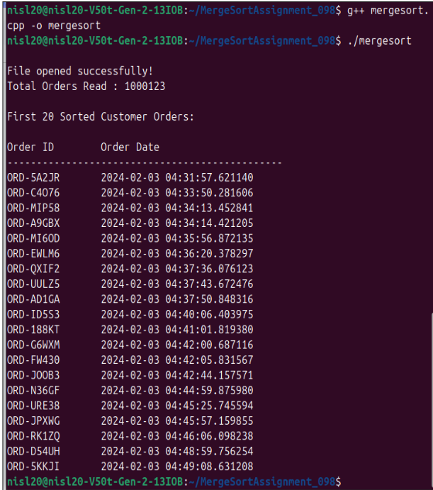

# Assignment 1: Customer Order Sorting

## Problem Statement
An e-commerce company receives millions of customer orders, each tagged with a unique Order ID and a timestamp. In order to process orders in first-come, first-served sequence, sort the orders chronologically using the **Merge Sort** algorithm ($O(n \log n)$ time complexity).

## Algorithm: Merge Sort
- **Technique**: Divide and Conquer
- **Time Complexity**: $O(n \log n)$ (Best, Average, Worst case)
- **Space Complexity**: $O(n)$ auxiliary array space
- **Stability**: Stable sort

## Dataset
- `ecommerce_dataset_+1m.csv` containing fields: `orderID`, `orderDate`.

## How to Compile & Run
```bash
g++ -std=c++17 assignment-1.cpp -o assignment-1
./assignment-1
```

## Output Screenshot

