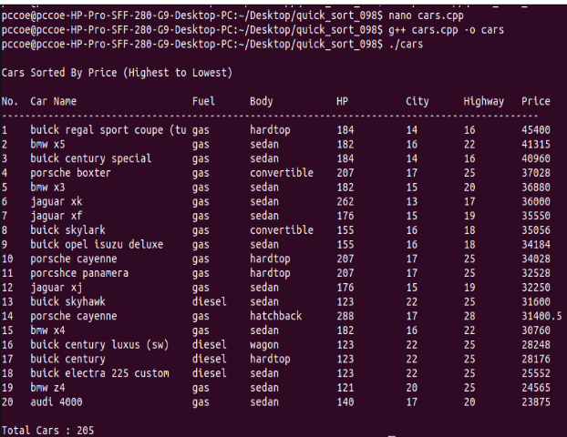

# Assignment 2: Car Price Sorting

## Problem Statement
Given an automotive dataset with car specifications (Name, Fuel Type, Body Style, Horsepower, City MPG, Highway MPG, and Price), sort the vehicles in descending order of price using **Quick Sort** to recommend premium vehicle models.

## Algorithm: Quick Sort
- **Technique**: Divide and Conquer (Lomuto Partition Scheme)
- **Time Complexity**:
  - Best & Average Case: $O(n \log n)$
  - Worst Case: $O(n^2)$
- **Space Complexity**: $O(\log n)$ recursive call stack

## Dataset
- `CarPrice_Assignment.csv`

## How to Compile & Run
```bash
g++ -std=c++17 assignment-2.cpp -o assignment-2
./assignment-2
```

## Output Screenshot

