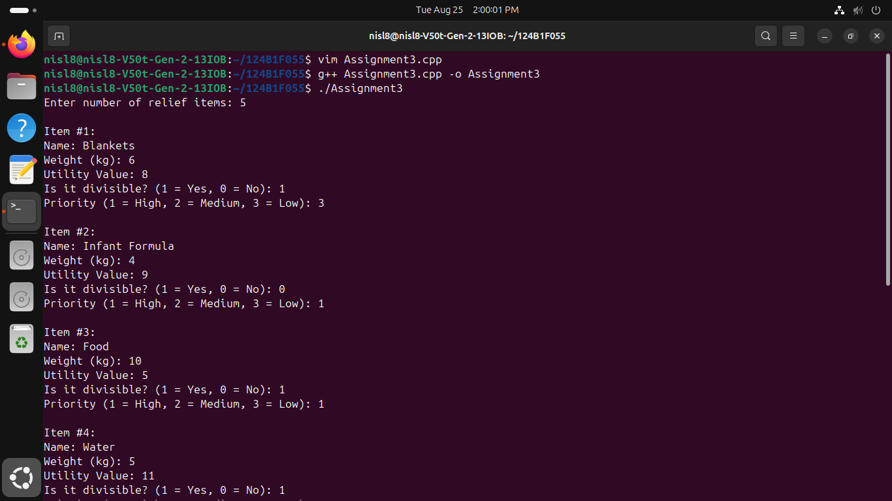
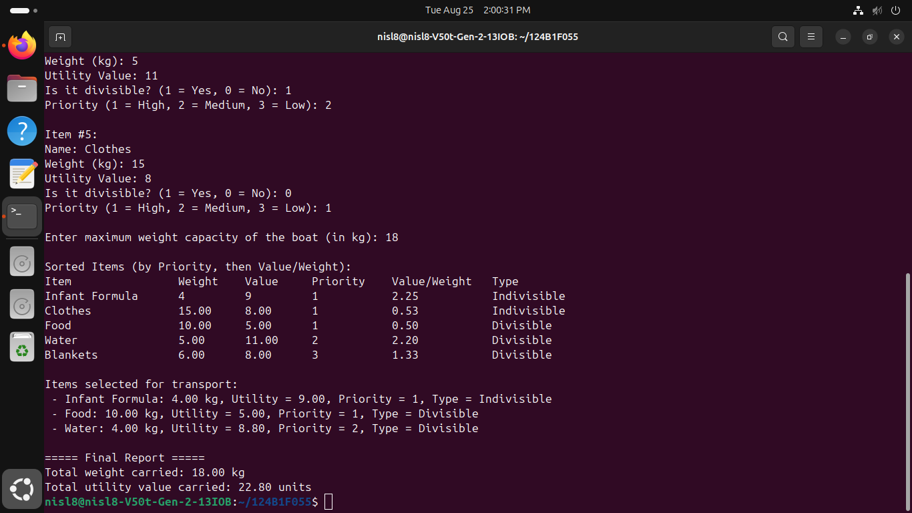

# Assignment 3: Emergency Relief Supply Distribution

## Problem Statement
During disaster response operations, a rescue boat with limited weight capacity must deliver relief supplies (e.g., medicine, food, water, blankets) to affected populations. Each item has:
- Weight (kg)
- Utility Value
- Divisibility (Divisible vs. Indivisible)
- Priority level (1 = High, 2 = Medium, 3 = Low)

Determine the optimal set of items (and fractions thereof) to load onto the boat to maximize total utility value.

## Algorithm: Fractional Knapsack (Priority-based)
- **Technique**: Greedy Strategy
- **Criterion**: Sort primarily by Priority (ascending), secondarily by Value-to-Weight ratio ($\frac{\text{Value}}{\text{Weight}}$) descending.
- **Time Complexity**: $O(n \log n)$ for sorting
- **Space Complexity**: $O(n)$

## How to Compile & Run
```bash
g++ -std=c++17 assignment-3.cpp -o assignment-3
./assignment-3
```

## Output Screenshots


