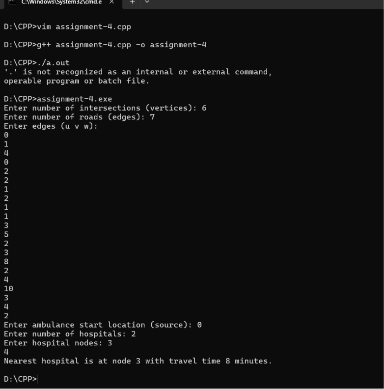
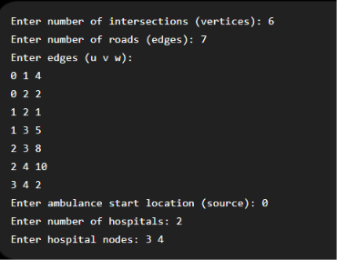

# Assignment 4: Smart Traffic Management for Emergency Ambulance

## Problem Statement
In an urban emergency scenario, an ambulance must navigate through a road network modeled as an undirected weighted graph (where vertices are intersections, edges are roads, and edge weights represent transit times in minutes) to reach the nearest accessible hospital.

## Algorithm: Dijkstra's Algorithm
- **Technique**: Single-Source Shortest Path (Greedy / Min-Priority Queue)
- **Time Complexity**: $O((V + E) \log V)$
- **Space Complexity**: $O(V + E)$

## How to Compile & Run
```bash
g++ -std=c++17 assignment-4.cpp -o assignment-4
./assignment-4
```

## Output Screenshots


