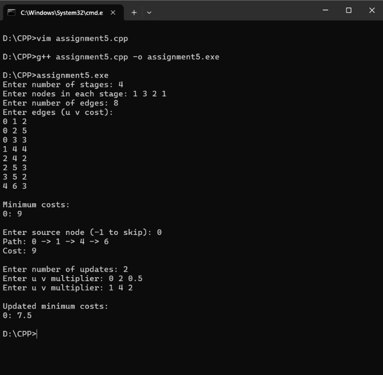

# Assignment 5: SwiftCargo Delivery Route Optimization

## Problem Statement
Optimize freight delivery routes across a multistage transportation network consisting of ordered stages from source distribution hubs to final retail centers. Edges only connect nodes in consecutive stages. The system must also support dynamic updates (e.g. weather delays or traffic congestion scaling base costs by multipliers) and recalculate the optimal path incrementally.

## Algorithm: Multistage Graph (Dynamic Programming)
- **Technique**: Backward Dynamic Programming & Incremental Queue-based propagation
- **Recurrence**:
  $$\text{cost}(i, j) = \min_{l \in \text{adj}[j]} \{ c(j, l) + \text{cost}(i+1, l) \}$$
- **Time Complexity**:
  - Initial solution: $O(V + E)$
  - Dynamic update: $O(V_{\text{affected}} + E_{\text{affected}})$
- **Space Complexity**: $O(V + E)$

## How to Compile & Run
```bash
g++ -std=c++17 assignment-5.cpp -o assignment-5
./assignment-5
```

## Output Screenshot

