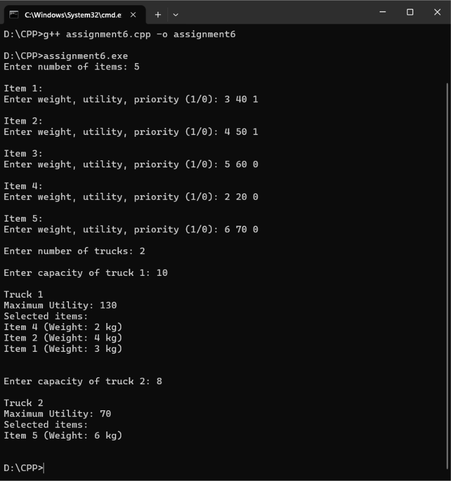

# Assignment 6: Multi-Truck Relief Supply Allocation

## Problem Statement
Distribute relief supply packages across multiple delivery trucks, each having an individual weight capacity. Each item has a weight, utility, and priority status (1 or 0). High-priority items receive an additional +10 utility points when packed. Solve for maximum utility across each truck using 0/1 Knapsack dynamic programming.

## Algorithm: 0/1 Knapsack with Multiple Trucks
- **Technique**: Dynamic Programming
- **Priority Bonus**: If $\text{priority} = 1$, effective utility = $\text{value} + 10$
- **Time Complexity**: $O(T \times n \times W)$ where $T$ is the number of trucks, $n$ is the number of items, and $W$ is truck capacity.
- **Space Complexity**: $O(n \times W)$ DP state table.

## How to Compile & Run
```bash
g++ -std=c++17 assignment6.cpp -o assignment6
./assignment6
```

## Output Screenshot

