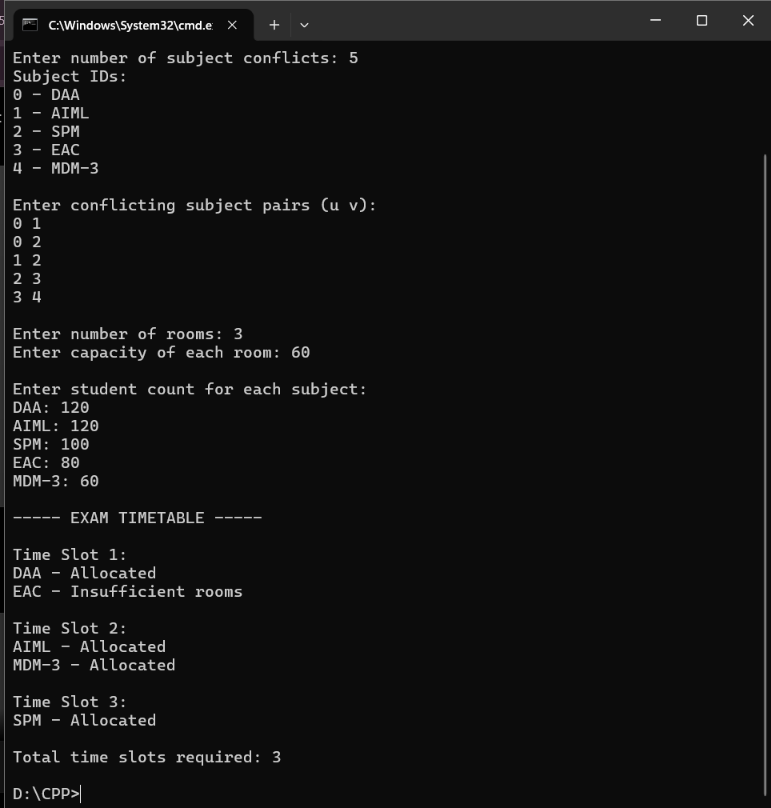

# Assignment 7: Exam Timetable & Room Allocation

## Problem Statement
University exams need to be scheduled for courses: DAA, AIML, SPM, EAC, and MDM-3. Given pairs of subjects with overlapping student enrollments, determine the minimum number of exam time slots such that no student has concurrent exams. Then allocate classroom spaces to verify if seating capacity satisfies student counts.

## Algorithm: Greedy Graph Coloring & Room Allocation
- **Technique**: Greedy Graph Coloring
- **Coloring**: Sequential vertex coloring selecting the lowest available integer color not assigned to any adjacent vertex.
- **Time Complexity**: $O(V^2 + E)$
- **Space Complexity**: $O(V^2)$ adjacency matrix

## How to Compile & Run
```bash
g++ -std=c++17 assignment7.cpp -o assignment7
./assignment7
```

## Output Screenshot

