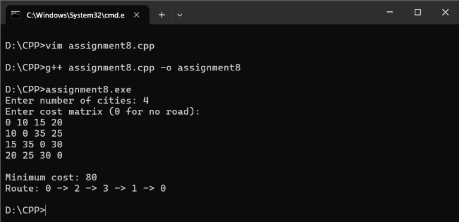

# Assignment 8: Traveling Salesperson Problem (TSP)

## Problem Statement
Given $n$ cities and an asymmetric/symmetric cost matrix representing travel distances between them, find the closed tour with the minimum total travel cost that visits every city exactly once and returns to the starting city.

## Algorithm: Least Cost Branch and Bound (Reduced Matrix Method)
- **Technique**: Branch and Bound (State-Space Tree exploration)
- **Bounding Function**: Row reduction followed by column reduction to determine the lower bound cost $c(\hat{x})$ of each node.
- **Priority Strategy**: Min-heap priority queue expanding states with the smallest lower bound.
- **Time Complexity**: $O(n^2 \cdot 2^n)$ in worst case; average case is significantly accelerated by bounding.
- **Space Complexity**: $O(n^2 \cdot 2^n)$ for state storage.

## How to Compile & Run
```bash
g++ -std=c++17 assignment8.cpp -o assignment8
./assignment8
```

## Output Screenshot

